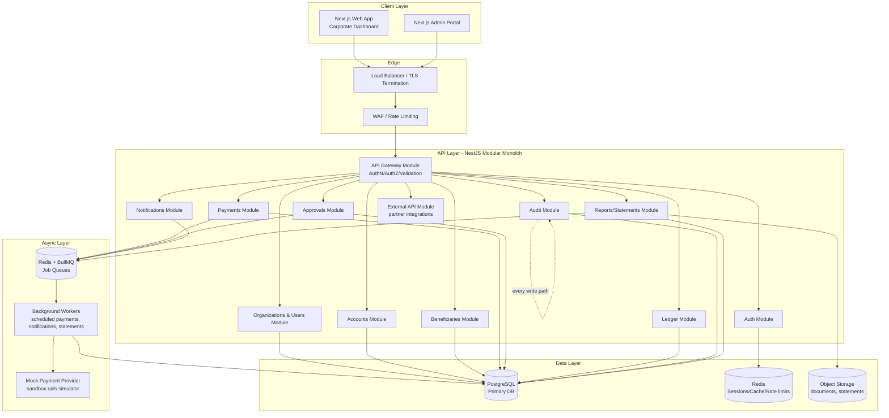
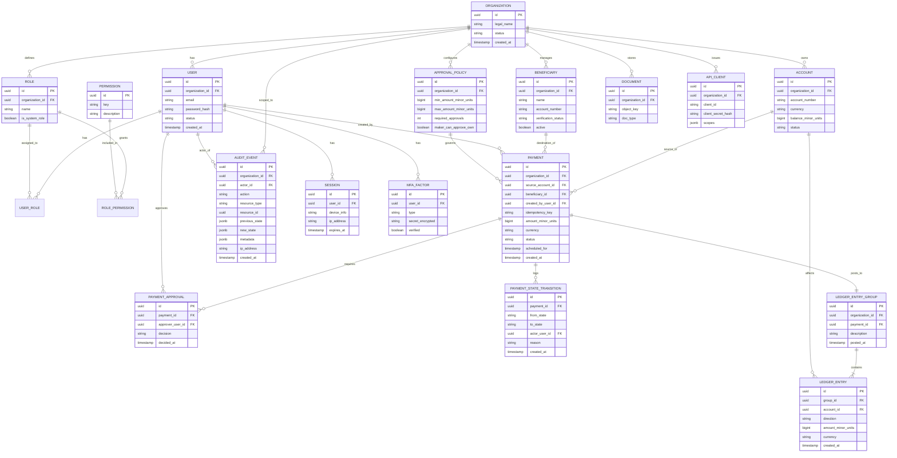
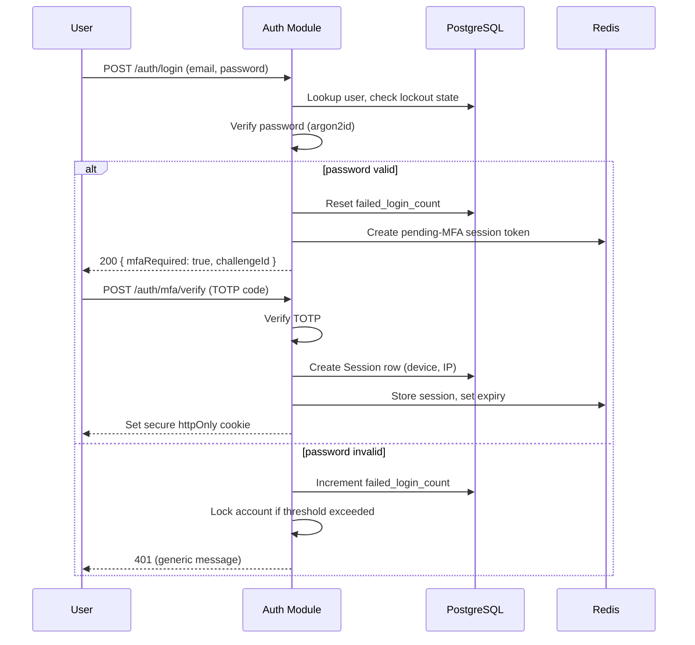
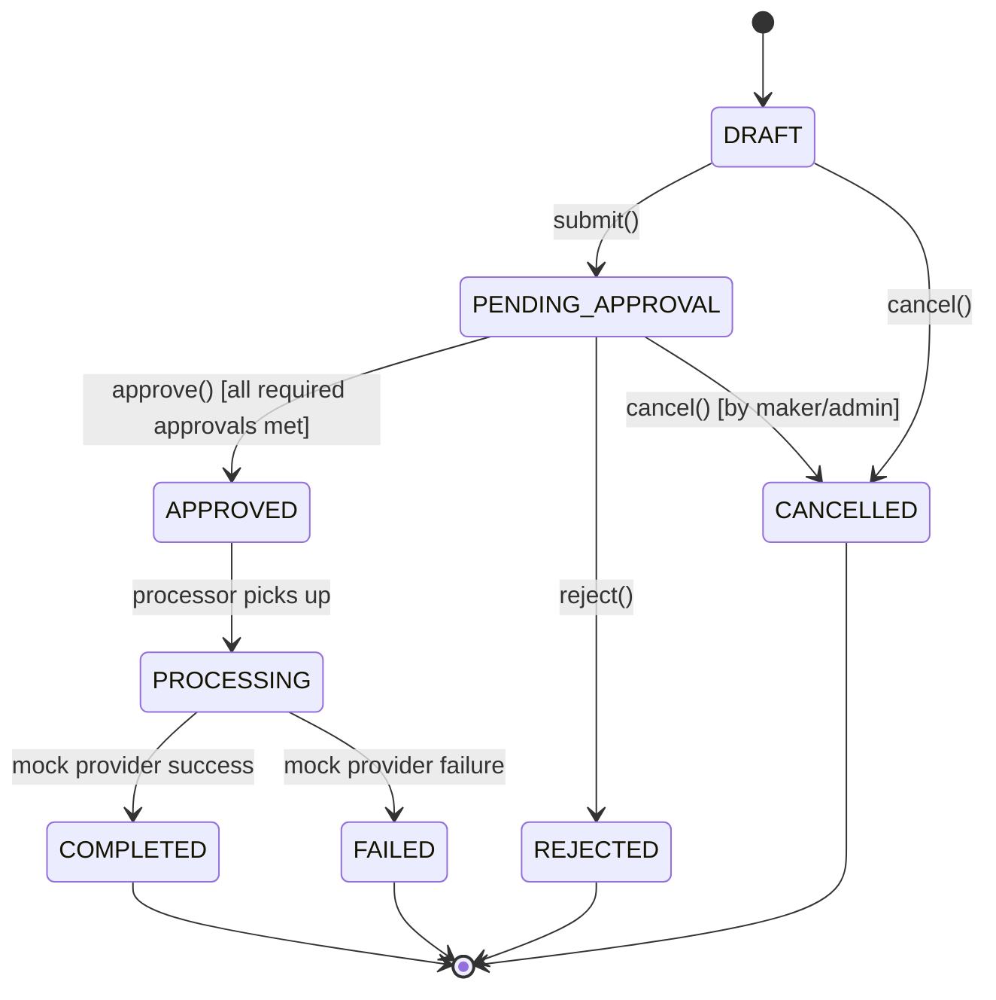
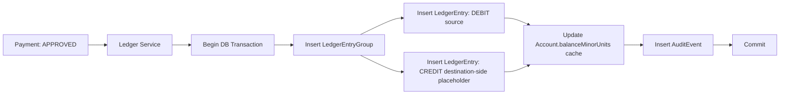
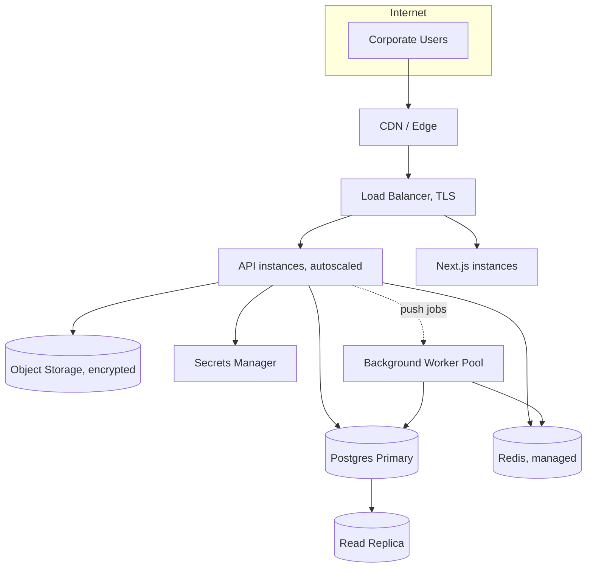

# Corporate Banking Platform — Phase 1: Architecture & Requirements

> Status: **DRAFT — awaiting approval.** No application code has been written. This document covers points 1–18 of the First Task. Nothing here should be read as a claim of regulatory compliance (see §13 Compliance Boundary).

---

## 1. Product Requirements

### 1.1 Confirmed scope (from your brief)
Corporate onboarding, multi-org/multi-user, RBAC, accounts, internal transfers, beneficiaries, payments with maker-checker approval, scheduled payments, limits, notifications, statements/reports, audit logs, admin portal, API access for approved integrations. Real money movement is explicitly out of scope — a sandbox/mock payment provider stands in for banking rails.

### 1.2 Missing requirements & assumptions (needs your decision)

| # | Topic | Assumption if you don't specify | Why it matters |
|---|---|---|---|
| 1 | Currency scope | Single currency (e.g. USD) at launch, schema supports multi-currency later | Affects ledger and FX complexity |
| 2 | Onboarding flow | Self-service signup + admin approval (KYB stub, not real KYC) | Real KYC/AML needs a licensed provider — out of scope for prototype |
| 3 | Org hierarchy | Flat organizations only, no parent/subsidiary org trees | Nested orgs multiply the authorization model significantly |
| 4 | Account types | Single "corporate current account" type at launch | Savings/FX/loan accounts would need distinct interest/limit logic |
| 5 | Payment rails | Only internal (book) transfers + a mock external-payment simulator | No real ACH/SWIFT/RTGS integration exists or is claimed |
| 6 | Scheduled payments | Cron-style recurring + future-dated one-off, executed by a background worker | Needs a job scheduler (BullMQ/Redis) |
| 7 | Approval policy model | Per-organization configurable rules: N-of-M approvers, amount-based tiers | You may want per-account or per-beneficiary policies too — flagged as a later phase |
| 8 | MFA method | TOTP (authenticator app) at launch; SMS/WebAuthn deferred | TOTP needs no third-party SMS provider |
| 9 | Notification delivery | Email (via provider abstraction) + in-app; SMS/push are stubbed interfaces only | Matches your notification requirement |
| 10 | Statements | PDF/CSV generation from ledger data, on-demand + monthly scheduled | Needs a PDF library and object storage |
| 11 | API access for integrations | OAuth2 client-credentials + scoped API keys per organization | You said "approved corporate integrations" — assumed machine-to-machine, not open signup |
| 12 | Data residency / hosting region | Not specified — flagged as an open question, not decided here | Real compliance requirement, jurisdiction-dependent |
| 13 | Environments | dev / staging / prod, single-region for prototype | Multi-region DR is a "before production" item, not Phase 1 |

**These are proposals, not decisions — flag anything you want changed before Phase 2.**

---

## 2. System Architecture

Modular monolith to start (NestJS), not microservices — a maker-checker banking domain has heavy cross-module transactional integrity requirements (payment → ledger → audit in one DB transaction), which microservices would fight against prematurely. Modules are cleanly bounded so a future split (e.g. carving out the ledger service) is a refactor, not a rewrite.



Key architectural decisions:
- **Every module that mutates state writes an audit event in the same DB transaction** — audit is not a side-channel logger, it's part of the write path (see §10).
- **Ledger module is the only module allowed to write balance-affecting rows.** Payments module never touches balances directly — it emits ledger instructions (see §8 Ledger Design).
- **Background workers** own anything time-based or externally-integrated (scheduled payments, mock rail calls, statement generation, email sending), so the request/response path stays fast and idempotent retries are centralized.

---

## 3. Database ER Diagram (core entities)



---

## 4. Core Database Schema (illustrative Prisma-style, not final DDL)

```prisma
model Organization {
  id           String   @id @default(uuid())
  legalName    String
  status       OrgStatus @default(PENDING)
  createdAt    DateTime @default(now())
  users        User[]
  accounts     Account[]
  beneficiaries Beneficiary[]
  roles        Role[]
  approvalPolicies ApprovalPolicy[]
  auditEvents  AuditEvent[]

  @@index([status])
}

model User {
  id              String   @id @default(uuid())
  organizationId  String
  organization    Organization @relation(fields: [organizationId], references: [id])
  email           String
  passwordHash    String
  status          UserStatus @default(ACTIVE)
  failedLoginCount Int @default(0)
  lockedUntil     DateTime?
  mfaFactors      MfaFactor[]
  sessions        Session[]
  userRoles       UserRole[]
  createdAt       DateTime @default(now())

  @@unique([organizationId, email])
  @@index([organizationId])
}

model Account {
  id                 String   @id @default(uuid())
  organizationId     String
  organization       Organization @relation(fields: [organizationId], references: [id])
  accountNumber      String   @unique
  currency           String
  balanceMinorUnits  BigInt   @default(0)   // derived/cached — source of truth is LedgerEntry sum
  status             AccountStatus @default(ACTIVE)
  createdAt          DateTime @default(now())

  @@index([organizationId])
}

model Payment {
  id                 String   @id @default(uuid())
  organizationId     String
  sourceAccountId    String
  beneficiaryId      String
  createdByUserId    String
  idempotencyKey     String   @unique
  amountMinorUnits   BigInt
  currency           String
  status             PaymentStatus @default(DRAFT)
  scheduledFor       DateTime?
  createdAt          DateTime @default(now())
  updatedAt          DateTime @updatedAt
  approvals          PaymentApproval[]
  transitions        PaymentStateTransition[]
  ledgerGroup        LedgerEntryGroup?

  @@index([organizationId, status])
  @@index([sourceAccountId])
}

model LedgerEntryGroup {
  id             String   @id @default(uuid())
  organizationId String
  paymentId      String?  @unique
  description    String
  postedAt       DateTime @default(now())
  entries        LedgerEntry[]
}

model LedgerEntry {
  id             String   @id @default(uuid())
  groupId        String
  group          LedgerEntryGroup @relation(fields: [groupId], references: [id])
  accountId      String
  direction      LedgerDirection  // DEBIT | CREDIT
  amountMinorUnits BigInt
  currency       String
  createdAt      DateTime @default(now())

  @@index([accountId])
  @@index([groupId])
}

model AuditEvent {
  id             String   @id @default(uuid())
  organizationId String?
  actorId        String?
  action         String
  resourceType   String
  resourceId     String?
  previousState  Json?
  newState       Json?
  metadata       Json?
  ipAddress      String?
  userAgent      String?
  createdAt      DateTime @default(now())

  @@index([organizationId, createdAt])
  @@index([resourceType, resourceId])
}

enum PaymentStatus {
  DRAFT
  PENDING_APPROVAL
  APPROVED
  REJECTED
  CANCELLED
  PROCESSING
  COMPLETED
  FAILED
}

enum LedgerDirection {
  DEBIT
  CREDIT
}
```

`balanceMinorUnits` on `Account` is a **cached/derived** value, refreshed transactionally on every ledger post — the actual source of truth for balance is always `SUM(LedgerEntry)` (see §8).

All money fields use `BigInt` minor units (cents), never floats.

---

## 5. API Endpoint Specification (representative subset)

Base path: `/api/v1`. Full OpenAPI spec generated from NestJS decorators in Phase 2; this is the shape.

| Method | Path | Purpose | Auth |
|---|---|---|---|
| POST | `/auth/login` | Email+password login, returns MFA challenge or session | Public |
| POST | `/auth/mfa/verify` | Complete MFA challenge | Session (pending) |
| POST | `/auth/logout` | Revoke current session | Session |
| POST | `/auth/password/reset-request` | Start password reset | Public (rate-limited) |
| GET | `/organizations/me` | Current org profile | Session |
| GET | `/users` | List users in org | `users.manage` or self-org read |
| POST | `/users` | Invite user | `users.manage` |
| PATCH | `/users/:id/roles` | Change role assignment | `users.manage` |
| GET | `/accounts` | List accounts (paginated, filterable) | `accounts.read` |
| GET | `/accounts/:id/transactions` | Transaction history | `accounts.read` |
| POST | `/beneficiaries` | Create beneficiary | `beneficiaries.create` |
| POST | `/beneficiaries/:id/approve` | Approve new beneficiary | `beneficiaries.approve` |
| POST | `/payments` | Create payment (DRAFT or submit) | `payments.create` |
| GET | `/payments` | List/filter payments | `payments.read` |
| POST | `/payments/:id/submit` | DRAFT → PENDING_APPROVAL | `payments.create`, owner |
| POST | `/payments/:id/approve` | Approver decision | `payments.approve`, policy-checked |
| POST | `/payments/:id/reject` | Approver rejection | `payments.approve` |
| POST | `/payments/:id/cancel` | Maker/admin cancellation | `payments.cancel` |
| GET | `/approvals/pending` | Approver's queue | `payments.approve` |
| GET | `/reports/statements/:accountId` | Generate/fetch statement | `reports.read` |
| GET | `/audit-events` | Query audit trail | `audit.read` |
| POST | `/api-clients` | Issue integration API credentials | `admin` |

Conventions: cursor-based pagination (`?cursor=&limit=`), `Idempotency-Key` header required on all POST endpoints that create financial records, consistent error envelope (per your §14 example), OpenAPI 3.1 doc auto-published at `/api/docs`.

---

## 6. Authentication Architecture



- **Password hashing:** argon2id (via a maintained library, not custom crypto), with per-user salt baked in by the library.
- **MFA:** TOTP (RFC 6238) at launch; factor secrets encrypted at rest (KMS-managed key).
- **Sessions:** server-side session record in Postgres + Redis cache for fast lookup; httpOnly, Secure, SameSite=Strict cookies; sliding expiration with an absolute cap (e.g. 12h absolute / 30min idle).
- **Lockout:** exponential backoff after N failed attempts, full lock after a higher threshold requiring admin or reset-flow unlock.
- **Rate limiting:** per-IP and per-account on all auth endpoints (Redis token bucket).
- **Password reset:** single-use, short-TTL signed token emailed to the registered address; invalidates all active sessions on completion.
- **No custom cryptography anywhere** — argon2/bcrypt, `crypto` (Node) or a vetted library for tokens, TOTP via a maintained package.

---

## 7. Authorization Model (RBAC + permissions)

- **Permissions are the atomic unit** (`payments.approve`, `accounts.read`, etc. — your list in §6 of the brief). Roles are named bundles of permissions, scoped per-organization so an org admin can customize roles without code changes.
- **Every API handler declares required permission(s) via a decorator**, enforced by a NestJS guard that runs before the handler — never trusted from the client.
- **Tenant isolation is enforced at the query layer**, not just the handler: a Prisma middleware/extension injects `organizationId = :currentOrgId` into every query against tenant-owned tables, and a repository-level check throws if a resource's `organizationId` doesn't match the caller's session — defense in depth against IDOR even if a handler-level check is missed.
- **Maker-checker rule enforcement:** `ApprovalPolicy.makerCanApproveOwn` (default `false`) is checked in the approval handler; a user cannot approve a payment where `payment.createdByUserId === session.userId` unless the org has explicitly opted in.

Default seeded roles: Organization Admin, Finance Manager, Payment Maker, Payment Approver, Viewer, Auditor — each mapped to a permission set editable per-org.

---

## 8. Payment State Machine



Rules enforced by a single `PaymentStateMachine` service (no controller or module is allowed to write `payment.status` directly):
- Transition table is explicit — any transition not in the table throws.
- Every transition requires: actor, authorization check for that specific transition, and is wrapped in one DB transaction with its `PaymentStateTransition` audit row.
- `PENDING_APPROVAL → APPROVED` requires evaluating `ApprovalPolicy` (N-of-M, amount tier) — the transition only fires once policy conditions are satisfied, not on a single approve click if the policy needs more.
- `APPROVED → PROCESSING → COMPLETED/FAILED` is driven by a background worker calling the mock payment provider, never inline in the request/response cycle (so a slow/flaky sandbox call can't hold an HTTP request open).
- `idempotencyKey` (client-supplied, unique) on `Payment` prevents duplicate submission at the create step.

---

## 9. Ledger Model

- **Payment** = intent/record (what the user asked for).
- **Payment execution** = the processing attempt against the mock provider.
- **Ledger entry group + entries** = the actual financial fact, double-entry: every posted group has balanced debit/credit rows summing to zero per currency.
- **Account.balanceMinorUnits** is a cache, refreshed inside the same transaction as the ledger post; nightly (and on-demand) reconciliation job recomputes it from `SUM(LedgerEntry)` and alerts on drift — drift should be impossible if writes only ever go through the ledger service, but the job exists to catch bugs early.
- The UI transaction list is a **read model** built from ledger entries, not a separate mutable record — there's exactly one source of truth for money.



---

## 10. Audit Architecture

- Audit writes happen **inside the same transaction** as the business mutation they describe — an audit row and its triggering change either both commit or both roll back.
- Audit rows are **append-only**: no `UPDATE`/`DELETE` grants on `audit_event` for the application's DB role; only an `INSERT`. A separate, more privileged role would be needed for any archival/retention job, and that job is out of scope for the prototype.
- Fields match your §12 shape exactly: `actorId, organizationId, action, resourceType, resourceId, timestamp, ipAddress, userAgent, previousState, newState, metadata`.
- **Never logged:** passwords, MFA secrets, session tokens, API secrets, full card/account numbers (masked), raw request bodies containing credentials.
- A thin `AuditService.record()` is the only way to write an audit row — enforced by not exporting the Prisma model's write methods outside that service.

---

## 11. Project / Folder Structure

```
corporate-banking-platform/
├── apps/
│   ├── api/                      # NestJS backend
│   │   ├── src/
│   │   │   ├── modules/
│   │   │   │   ├── auth/
│   │   │   │   ├── organizations/
│   │   │   │   ├── users/
│   │   │   │   ├── accounts/
│   │   │   │   ├── beneficiaries/
│   │   │   │   ├── payments/
│   │   │   │   ├── approvals/
│   │   │   │   ├── ledger/
│   │   │   │   ├── audit/
│   │   │   │   ├── notifications/
│   │   │   │   ├── reports/
│   │   │   │   └── api-clients/
│   │   │   ├── common/            # guards, decorators, filters, interceptors
│   │   │   ├── config/            # env schema/validation
│   │   │   └── main.ts
│   │   ├── prisma/
│   │   │   ├── schema.prisma
│   │   │   └── migrations/
│   │   └── test/                  # e2e, integration
│   ├── web/                       # Next.js corporate dashboard
│   │   └── src/{app,components,lib}
│   └── admin/                     # Next.js admin portal (or a route group in web)
│       └── src/{app,components,lib}
├── packages/
│   ├── shared-types/               # DTOs/enums shared FE<->BE
│   └── ui/                         # shared component library
├── infra/
│   ├── docker-compose.yml
│   ├── docker/
│   └── deploy/                     # IaC placeholders, not implemented yet
├── .env.example
└── docs/
    └── architecture/                # this document and future ADRs
```

Monorepo (pnpm workspaces or Turborepo) so shared types stay in sync between API and frontends without duplication.

---

## 12. Security Threat Model (STRIDE-style summary)

| Threat | Mitigation |
|---|---|
| SQL injection | ORM-parameterized queries only; no raw SQL string concatenation |
| XSS | React's default escaping, strict CSP headers, output encoding on any server-rendered user content |
| CSRF | SameSite=Strict cookies + double-submit CSRF token on state-changing requests |
| SSRF | No user-controlled URLs fetched server-side; mock payment provider is an internal service, not a user-supplied endpoint |
| Broken access control / IDOR | Tenant-scoping middleware + permission guards on every handler (§7) |
| Credential stuffing / brute force | Rate limiting + account lockout + MFA |
| Session hijacking | httpOnly/Secure cookies, session binding to device fingerprint, short idle timeout |
| Replay attacks | Idempotency keys on financial mutations; nonce/timestamp on API-client requests |
| Duplicate transactions | Unique `idempotencyKey` constraint at the DB level, not just app-level check |
| Race conditions on approval/balance | Row-level locking (`SELECT ... FOR UPDATE`) inside ledger-posting transactions |
| Privilege escalation | Role/permission changes are themselves audited and require `users.manage`; no self-service role elevation |
| Secrets exposure | Env-var based config, `.env.example` only, secrets manager in real deployment (not committed) |
| Dependency vulnerabilities | Automated dependency scanning (`npm audit` / Dependabot/Snyk) in CI |

---

## 13. Compliance Boundary (explicit)

This is a **software prototype**. Nothing in this architecture — encryption, audit logs, RBAC, maker-checker — constitutes legal compliance with banking regulation. Before any production deployment involving real funds or real customer data, the following need review by qualified legal/compliance professionals, and are **not** addressed by this document:

- Banking license / e-money license requirements in your target jurisdiction(s)
- AML/KYC/CDD obligations and a licensed identity-verification provider
- Real payment rail integration (ACH/SEPA/RTGS/SWIFT) and the compliance obligations that come with each
- Data protection law (GDPR/CCPA/local equivalents) — data residency, retention, subject access rights
- Regulatory reporting obligations (SARs, transaction monitoring thresholds, etc.)
- PCI DSS if any card data is ever touched
- Third-party security audit / penetration test before go-live
- Business continuity / disaster recovery requirements a regulator may mandate

---

## 14. Development Phases

Following your §19 exactly — Phases 1–16 as you listed them. After each phase: explain what was implemented, list files changed, run tests, report remaining problems (not silently skipped), and wait for your approval before proceeding. No phase will touch code outside its own scope.

---

## 15. Local Development Setup (planned, not yet created)

- `docker-compose.yml` bringing up: Postgres, Redis, API (NestJS, hot-reload), Web (Next.js dev server), Admin.
- `pnpm install && pnpm dev` at the repo root via Turborepo pipeline.
- `.env.example` covering DB URL, Redis URL, JWT/session secrets (placeholder values only), mock-provider config.
- Prisma migrations run automatically on API container start in dev.

---

## 16. Testing Strategy

Matches your §18 list directly:
- **Unit tests:** state machine transitions, permission evaluation logic, ledger balance math (Jest).
- **Integration tests:** module-to-DB interactions against a real Postgres test instance (Testcontainers), not mocks, for anything touching money.
- **API tests:** Supertest against the NestJS app, including the full negative-test list from your §18 (cross-org access attempt, maker-approves-own-payment, duplicate submission, limit exceeded, invalid transition).
- **E2E tests:** Playwright over the Next.js apps for the core maker-checker journey.
- CI gate: no merge if tests fail; failed tests are surfaced, never skipped or weakened to pass.

---

## 17. Production Deployment Architecture (target shape, not built yet)



Encryption in transit everywhere (TLS), encryption at rest for Postgres/object storage, secrets pulled from a managed secrets service (not env files) in real deployments, structured security logging shipped to a SIEM. Actual cloud provider/region/DR posture is an open question (§18).

---

## 18. Open Questions & Assumptions (needs your input before Phase 2)

1. Target jurisdiction(s) and hosting region — affects data residency assumptions even for a prototype.
2. Do you want multi-currency from day one, or single-currency with the schema simply supporting it later?
3. Should organizations support parent/subsidiary hierarchies, or stay flat?
4. Any preference between NestJS vs. another structured framework, or is NestJS confirmed?
5. Preferred object storage abstraction target (S3-compatible assumed) — any constraint here?
6. Should the API-access feature (§21 in your brief) support full self-service integration signup, or admin-provisioned only, at launch?
7. Any existing design system / brand guidelines for the dashboard, or should Phase-later frontend work start from a clean design?

---

**Nothing beyond this document has been built.** Once you approve (or amend) this architecture, Phase 2 (project scaffolding) begins.
